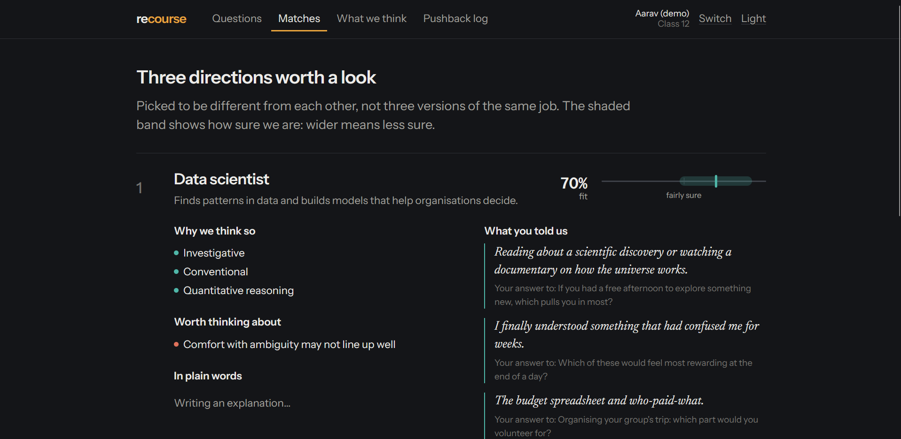

# Recourse

A personalised career and education advisor for Indian students that keeps an evidence-based model of the student, explains every recommendation, and lets the student push back.

Most career tests give a result and stop there. Recourse treats a recommendation as a claim that the student can dispute. When a student says "that's not me", the system records the objection as new evidence, recalculates, shows exactly what changed, and asks a few follow-up questions to check again. It never deletes or edits what the student said before.



## Features

- **Adaptive assessment.** Each next question is the one expected to be most useful, given what the system is still unsure about. Every question comes with a plain-English reason for why it was asked. A session is about 20 questions, around five minutes. It can stop after 12 if nothing left is worth asking, but in the simulation evaluation every session used all 20.
- **A student model across four pillars.** Interests (Holland's RIASEC types), work values (O\*NET Work Importance Profiler), work style, and self-reported abilities.
- **Belief with uncertainty.** For every attribute the system keeps an estimate and a separate confidence. The UI draws both as an estimate with an uncertainty band. Contradictory answers lower confidence instead of being averaged away.
- **Explainable matching.** Careers are ranked by deterministic rules, with pillar-weighted scores and a small diversity penalty so the top three aren't all the same kind of job. Each match shows its reasons, its concerns, and the student's own answers behind them.
- **Recourse: contestable recommendations.**
  - The student can dispute a single piece of evidence or a whole recommendation.
  - Each objection becomes new evidence (source `CONTEST`), linked to what it disputes.
  - The system recalculates confidence, re-ranks, and logs the before and after.
  - It then opens a short follow-up session on the disputed areas.
  - A dispute is evidence, not an override: if the follow-up answers confirm the original reading, the match can stay.
- **Pushback log.** Every contest and its effect on the ranking is kept and visible to the student.
- **Pilot feedback.** After a student's first contest, a short card asks for three 1 to 5 ratings and an optional comment. It is asked once per student and can be exported as CSV.
- **Return codes instead of accounts.** At signup each student gets a short code such as `K7P-3QX` (no 0, O, 1 or I, so it is hard to misread). They come back with their name and that code. The app never lists other students.
- **Local explanations.** A small language model running on the same machine (Phi-4-mini through Ollama) rewrites the computed facts as a short note. It only rephrases. It never ranks, scores or decides. If it is slow or unavailable, a deterministic template is used instead.
- **Indian context.** Each career lists Indian education routes and entrance exams, with sources.
- **Runs offline.** There are no paid APIs and no cloud services, and the database is an embedded file.

## How it works

```
answers ──> evidence ──> beliefs ──> matches ──> explanation
              ^           (estimate +   (rules,     (local LLM,
              |            confidence)   traceable)  or template)
              |                              |
              └──── contest (new evidence) <─┘
```

1. **Evidence.** Each answer option in `questions.json` maps to one or more pieces of evidence: an attribute, a direction (supports or contradicts) and a strength. Evidence is append-only.
2. **Belief.** For each attribute, supporting and contradicting evidence are combined separately with a noisy-OR. Each new item closes part of the remaining gap, so repeated similar answers have diminishing effect. Confidence grows with the amount of evidence and falls when the evidence disagrees with itself. How far it falls depends on the balance between support and contradiction, so later consistent answers can gradually win some confidence back after a dispute.
3. **Question selection.** Each question is scored by information value × importance × reliability × discrimination ÷ effort. After at least 12 questions, the assessment stops when 70% of attributes are known with reasonable confidence or no remaining question is worth asking. It never goes past 20.
4. **Matching.** Each career's interest weights come from its O\*NET interest code (one to three RIASEC letters, the first weighted most). Its work-value, work-style and ability weights are set by hand, informed by the O\*NET description (see [docs/career-verification.md](docs/career-verification.md)). A match combines the four pillars (interests 40%, abilities 25%, values 20%, work style 15%). Every score can be traced down to individual pieces of evidence.
5. **Contest.** An objection adds counter-evidence, beliefs and ranking are recomputed, the change is logged, and a follow-up session focuses on the disputed attributes.

## Tech stack

| Part | Technology |
|---|---|
| Backend | Java 21, Spring Boot 3.3, Spring Data JPA, Maven |
| Database | H2, embedded, file-based (`backend/data/`) |
| Frontend | React 18, TypeScript, Vite, plain CSS with variables |
| Language model | Ollama with `phi4-mini`, called over local HTTP (optional) |
| Tests | JUnit 5, Spring Boot Test |

## Project structure

```
backend/                     Spring Boot application (package com.recourse)
  engine/                    Pure Java core with no framework code: evidence, beliefs,
                             question selection, matching, contests
  data/                      Loads questions.json (37 questions) and careers.json (25 careers)
  store/                     JPA entities and repositories (evidence is append-only)
  service/                   Assessment, recommendations, contests, student profile, demo seed
  explain/                   Ollama client and explanation service with template fallback
  api/                       REST controller under /api/v1
frontend/                    React app (welcome, questions, matches, profile, pushback log)
prototypes/                  Earlier Python prototypes the engine was ported from
```

## Running it on Windows

### Requirements

- Java 21 (JDK)
- Maven 3.9 or later
- Node.js 18 or later (with npm)
- Optional: [Ollama](https://ollama.com) for written explanations. Without it, the app uses its built-in template explanations.

### 1. Optional: start the language model

```
ollama pull phi4-mini
```

Ollama runs in the background after installation, on `http://localhost:11434`.

### 2. Start the backend

```
cd backend
mvn spring-boot:run
```

The API runs on `http://localhost:8080`. To check it, open `http://localhost:8080/api/v1/system`, which reports whether the language model is reachable.

### 3. Start the frontend

In a second terminal:

```
cd frontend
npm install
npm run dev
```

Open `http://localhost:5173`. In development, the frontend forwards `/api` requests to the backend.

### Demo data

The `demo` profile creates three example students on startup. Each one answers the real adaptive assessment through the same services a real student uses, so their evidence is genuine. The profile does nothing if the students already exist.

Demo students are kept in their own database file (`backend/data/demo/`), separate from real students (`backend/data/recourse.*`). Resetting the demo never touches real data.

| Student | Return code | Stage | Leans towards |
|---|---|---|---|
| Aarav (demo) | DEM-AAR | Class 12 | Maths, analysis, research |
| Meera (demo) | DEM-MRA | College | People, communication, teamwork. Also has one contest on her top match, followed by a follow-up session that re-confirms it. |
| Kabir (demo) | DEM-KBR | Class 10 | Art, design, independence |

To open a demo student, use "Coming back?" on the welcome page with the name exactly as shown (any case) and its return code.

Command Prompt:

```
cd backend
mvn spring-boot:run -Dspring-boot.run.profiles=demo
```

PowerShell (the argument needs quotes):

```
cd backend
mvn spring-boot:run "-Dspring-boot.run.profiles=demo"
```

To reset the demo, stop the backend, delete the demo database, then start again with the demo profile:

- Command Prompt: `rmdir /s /q backend\data\demo`
- PowerShell: `Remove-Item -Recurse -Force backend\data\demo`

To clear real students instead (this deletes their answers for good), stop the backend and delete only the main database files:

- Command Prompt: `del backend\data\recourse.*`
- PowerShell: `Remove-Item backend\data\recourse.*`

## Tests

```
cd backend
mvn test
```

This runs 108 tests:

| Area | Tests |
|---|---|
| Engine: belief calculation, question selection, matching, evidence and contests | 49 |
| Data files: questions and careers load and are valid | 7 |
| End-to-end flow through the real services and an in-memory database | 8 |
| Demo seed: personas, their return codes, idempotency, the contest used in the live demo, and its separate database | 9 |
| Return codes: format, uniqueness, forgiving input, same answer for a wrong name or code, no student list | 11 |
| Pilot feedback: asked only after the first contest, ratings 1 to 5, one per student, CSV export without names and with safe escaping | 7 |
| Explanations: the fallback template, and removing a letter-style greeting or sign-off from the model's text | 5 |
| Resuming the questions: a reload continues the same session and count, a finished student isn't asked again, unfinished follow-ups are picked up | 6 |
| Model warm-up at startup: runs in the background, never blocks startup, failures are ignored | 3 |
| Evaluation helpers: the statistics, persona generation and simulated answering used by the evaluation | 3 |

The frontend is type-checked as part of its build:

```
cd frontend
npm run build
```

## Pilot feedback export

After a student's first contest, the app shows a short card with three ratings from 1 (not at all) to 5 (completely):

- The matches made sense
- The explanation helped
- Pushing back felt like it worked

There is also an optional comment. The card tells students: "Your answers are saved without your name and may be used in a student project report." A student who chooses "Not now" can still answer later from a "Share feedback" link in the pushback log. Each student can give feedback once.

With the backend running, download every answer as a CSV file from:

```
http://localhost:8080/api/v1/feedback/export
```

The file has no names. Each row has the submission time, a short student reference, the student's stage, what was disputed, the three ratings and the comment. Comments that begin with `=`, `+`, `-` or `@` get a leading apostrophe so a spreadsheet shows them as text instead of running them as formulas.

## Explanation benchmark

An opt-in benchmark times the app's real explanation prompt on the demo students' recommendations: 9 prompts, repeated 3 times, plus one cold-start call. It isn't part of `mvn test`. With Ollama running:

```
cd backend
mvn test -Pbenchmark -Dbenchmark.model=phi4-mini
```

Results are appended to `backend/benchmark-results.csv`, one row per call, including the full text.

Results from one laptop (27 timed calls per model):

| | phi4-mini | llama3.2:3b | qwen2.5:3b |
|---|---|---|---|
| Median response time | 7.7 s | 7.8 s | 7.7 s |
| 90th percentile | 9.3 s | 10.4 s | 8.7 s |
| Within the app's 20 s timeout | 27/27 | 27/27 | 27/27 |
| Invites the student to disagree, as the prompt asks | 25/27 | 5/27 | 9/27 |
| Kept to the requested 3 to 4 sentences | 16/27 | 23/27 | 14/27 |

All three models were equally fast. Phi-4-mini was kept because it followed the instruction most relevant to Recourse, inviting the student to disagree, far more reliably.

## Simulation evaluation

An opt-in evaluation runs 30 simulated students through the real assessment, recommendation and contest services, with an in-memory database. It isn't part of `mvn test`:

```
cd backend
mvn test -Pevaluation
```

It takes about 30 seconds and writes to `docs/evaluation/`:

- `summary.md`: the method and all results in tables, each metric explained in one line
- `personas.csv`: each simulated student's true leans on the 24 attributes
- `recovery.csv`: true level against final belief, per student and attribute
- `top3.csv`: each student's top 3 and whether it includes their target career family
- `noise.csv`: top 3 with 10% and 20% of answers replaced by random choices
- `adaptivity.csv`: the question sequence each student was asked
- `contest.csv`: before and after a dispute, and after the follow-up questions
- `question-curve.csv`: recovery and top-3 accuracy after 8, 12, 16 and 20 questions
- `metrics.csv`: every headline number, used to compare runs
- `baseline/`: the same evaluation with the prototype's original conflict formula, kept for comparison. `summary.md` has a before-and-after table.

Each simulated student has a known true lean on every attribute and answers each question by picking the option whose evidence best agrees with it. Everything is seeded, so a rerun gives the same numbers.

## API

All endpoints are under `/api/v1`.

| Method | Path | Purpose |
|---|---|---|
| GET | `/system` | Question and career counts, language model status |
| POST | `/students` | Create a student; the response includes their return code |
| POST | `/students/continue` | Come back with name and return code (there is no endpoint that lists students) |
| GET | `/students/{id}`, `/students/{id}/profile`, `/students/{id}/evidence` | Student, belief profile, full evidence trail |
| POST | `/students/{id}/sessions` | Start the questions, or carry on where the student left off (204 when there is nothing left to ask) |
| GET | `/sessions/{sessionId}/next` | Next question, with the reason it was chosen |
| POST | `/sessions/{sessionId}/answers` | Answer a question; returns how beliefs changed |
| GET | `/students/{id}/recommendations` | Top three matches with reasons, concerns and evidence |
| GET | `/students/{id}/recommendations/{careerId}/explanation` | Written explanation of one match |
| POST | `/students/{id}/contests/evidence` | Dispute a single piece of evidence |
| POST | `/students/{id}/contests/recommendation` | Dispute a recommendation |
| GET | `/students/{id}/contests` | Pushback log |
| GET, POST | `/students/{id}/feedback` | Whether the student has given pilot feedback; give it (once) |
| GET | `/feedback/export` | All pilot feedback as CSV, without names |

## Design principles

- **Decisions are rule-based and deterministic.** The same answers always give the same ranking. The language model writes explanations only.
- **Every recommendation carries its evidence trail.**
- **Nothing is deleted.** Disputes are added as new evidence that points at what it disputes, so the full history stays inspectable.
- **Career data is curated by hand.** Each career lists its sources and is marked as verified only after those sources have been checked. No career data is generated by the language model.

## Limitations and future work

- 25 careers and 37 questions. Phase 2 extends this to 40 to 60 careers and adds career adaptability and decision patterns.
- No user accounts yet. It is a single-machine prototype.
- Access control is deliberately simple. A name and return code are not a password: there is no limit on how many codes someone can try, and anyone who already has a student's internal id can open that student's data through the API. This is acceptable for a prototype that runs on one machine, but it would need proper accounts before being put online.
- Abilities are self-reported, not tested.
- Evaluation so far consists of automated tests, simulated personas and a model benchmark. A larger user study with real students is planned for phase 2.

## About

Final-year B.Tech project, The NorthCap University.
Harshit Pandita (23CSU119). Supervisor: Dr. Shilpa Mahajan.
